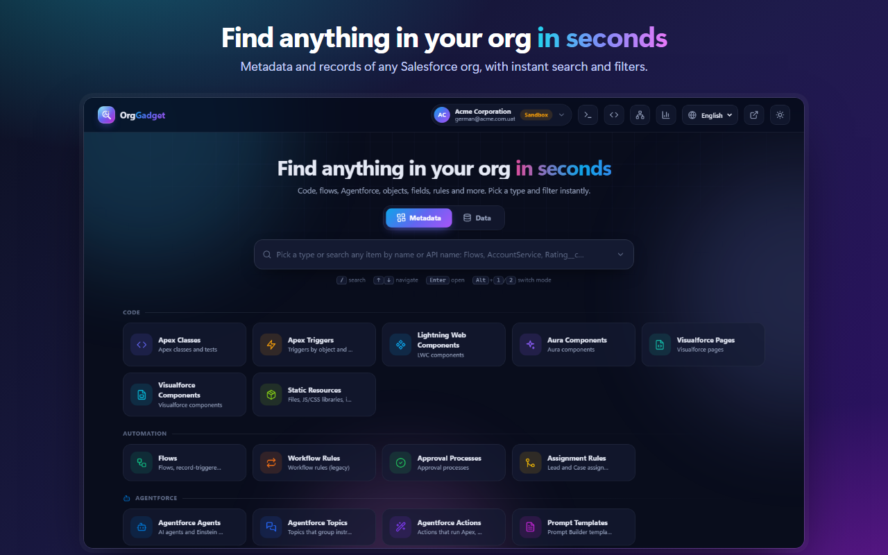

# OrgGadget – Toolkit for Salesforce

> Not affiliated with, sponsored or endorsed by Salesforce, Inc.

OrgGadget is a browser extension (Chrome / Edge, Manifest V3) that gives Salesforce admins and developers their whole org — **metadata and records** — in one fast, modern workspace. It works with production, sandbox, Developer Edition, scratch and trial orgs, and always acts with **your own user's permissions**.



## Install

**From the Chrome Web Store** — coming soon.

**From source (developer mode)**

1. Download or clone this repository.
2. Open `chrome://extensions` (or `edge://extensions`) and turn on **Developer mode**.
3. Click **Load unpacked** and select the project folder (the one that contains `manifest.json`).
4. Pin the OrgGadget icon to the toolbar.

To update a source install, pull the latest changes and click ↻ on the OrgGadget card in `chrome://extensions`.

## Getting started

1. Log in to your Salesforce org in a browser tab.
2. Click the OrgGadget icon → **Explore this org** (or press `Alt+Shift+O`).
3. The explorer opens in a new tab. Switch between **Metadata** and **Data**, pick a type or object, or just start typing.

Clicking any name takes you to that record or component in Salesforce; a toolbar button switches between opening links in a new tab or the same tab.

## Features

### Metadata explorer
- 30+ metadata types: Apex classes and triggers, Lightning Web Components, Aura, Visualforce, static resources, Flows, Workflow Rules, Approval Processes, Assignment Rules, Objects, Custom Fields, Validation Rules, Record Types, Global Value Sets, Duplicate Rules, Page Layouts, Lightning Pages, Custom Labels, Email Templates, Profiles, Permission Sets and Groups, Custom Permissions, Named Credentials, Reports and Dashboards.
- **Agentforce**: agents, topics, actions and prompt templates.
- **Custom Metadata**: Custom Metadata Types and every record of every `__mdt` type in one list.
- Filter by object (for example, the triggers or flows of one object), type, status and last modified date.
- **Live lists**: the open list re-syncs every minute and when you come back to the tab; new items are highlighted, edited ones flash and deleted ones disappear, without losing your filters.

### Conflict detection
Every metadata item gets an indicator — 🔴 conflict, 🟠 warning, 🟢 no conflicts. Clicking it explains **why** it happens, **what it clashes with** (with links) and **how to fix it**. The analysis is 100% rule-based and runs in your browser (rules live in `lib/conflicts.js`):

| Type | Checks |
|---|---|
| Apex Triggers | Several active triggers on the same object and event · coexistence with flows and Workflow Rules · invalid (needs recompile) · API version |
| Apex Classes | Name that shadows a system class (`Database`, `Test`…) or standard object · invalid · API version |
| Flows | Undefined or repeated trigger order · flows and triggers on the same object · unsupported Process Builder · newer version not activated · duplicate labels |
| Workflow Rules | Out of support since Dec 31, 2025 · field updates that re-run triggers and flows |
| Objects and fields | Close to the custom field limit · same-name fields across namespaces · duplicate labels |
| Validation Rules | Active rules with the same message on the same object |
| Agentforce actions | Action pointing to an Apex class, flow or prompt that doesn't exist or is inactive |
| Others | API versions, size limits, recalculation status, overlapping processes, duplicate values / endpoints / names |

### Records
- **Global search** across objects by name, email, subject or Id (SOSL plus a "contains" search on Subject, so recently created cases show up too).
- Records of any object with filters by name or Id, picklist values (status, stage…), owner ("My records only") and date ranges with quick presets.
- **Record panel**: every field your user can see, grouped and searchable. Edit fields inline (text, numbers, picklists, checkboxes, dates, lookups…) and save — validation rules, triggers and errors are reported right on the field. Formula, system and read-only fields show a lock with the reason.
- **Related records**: browse a record's child records (contacts, cases, tasks…) with counts, and open them in the same panel.

### SOQL console
- Data (REST API) and metadata (Tooling API) modes; the `FROM` is pre-filled with what you are looking at.
- Results as you type, syntax highlighting, autocomplete for objects, fields and keywords (`Tab`), and query history.
- **Export records** to Excel (`.xlsx`, with headers, filters and real dates), CSV (UTF-8) or JSON, or copy them as a table to paste into Excel or Google Sheets. Exports include every page of the query (up to 100,000 records).

### Built-in IDE
- Edit Apex classes and triggers, Visualforce pages and components, LWC and Aura bundles and **save them to your org** (`Ctrl+S`).
- Apex and Visualforce compile in Salesforce like in the Developer Console: errors are underlined on the exact line and listed in a problems panel. **Validate** compiles without saving.
- Warns before overwriting someone else's changes, asks for confirmation in production and blocks saving Apex in production (Salesforce requires a deployment with tests). Managed-package code is read-only.
- The editor (CodeMirror 6) loads only the first time you open the IDE, so it doesn't slow down the rest of the extension.

### Reports, dashboards and schema
- **Reports**: view them with live data and edit their design (groupings, columns, totals, filters, chart) with a live preview; changes are saved only when you click Save.
- **Dashboards**: view with real data, filter, refresh and edit components (Lightning dashboards).
- **Schema Builder**: an interactive canvas with your objects and their lookup / master-detail relationships. Drag, zoom, inspect fields and create custom fields.

### Everywhere
- Toolbar popup with the current org, other orgs with an active session (expired sessions are hidden) and four favorite shortcuts.
- English and Spanish, light and dark themes.

## Keyboard shortcuts

| Shortcut | Action |
|---|---|
| `Alt+Shift+O` | Open OrgGadget for the org in the current tab |
| `/` | Focus the search box |
| `↑` `↓` `Enter` | Navigate and open results |
| `Alt+1` / `Alt+2` | Switch between Metadata and Data |
| `Alt+Q` | Open the SOQL console |
| `Ctrl+Enter` | Run the query (console) · save the record (record panel) |
| `Ctrl+S` | Save code (IDE) |
| `1`–`4` | Favorite shortcuts (toolbar popup) |

## Security and privacy

- OrgGadget never asks for or stores your password. It reuses the Salesforce session you already have open and calls the Salesforce API with it.
- Everything respects your permissions: profile, permission sets, sharing and field-level security are enforced by Salesforce on every request.
- The only network destination is your own Salesforce org — no analytics, no tracking, no third-party servers, no remote code.
- Changes are sent to your org only when you explicitly save.

Read the full [privacy policy](PRIVACY.md).

## Development

### Project structure

```
manifest.json            Manifest V3
background.js            Keyboard shortcut and cleanup
popup/                   Toolbar popup: current org, active sessions, favorites
app/                     Explorer (full tab)
  app.js                 Boot, org header, modes and navigation (#m=Type / #d=Object)
  metadata-view.js       Metadata lists
  data-view.js           Records, filters and global search
  record-panel.js        Record panel, inline editing and related records
  conflict-drawer.js     Conflict details
  query-console.js       SOQL console
  export-menu.js         Export menu
  code-ide.js            IDE (Apex, Visualforce, LWC, Aura)
  analytics-view.js      Reports and dashboards hub
  report-editor.js       Report editor
  dashboard-editor.js    Dashboard viewer / editor
  schema-view.js         Schema Builder
  charts.js              Lightweight SVG charts
  combobox.js, ui.js     UI building blocks, icons, formatting, storage
lib/
  session.js             Salesforce session detection (cookies) and validation
  sfapi.js               REST / Tooling API client
  metadata-types.js      Metadata type catalog (queries, mapping, URLs)
  conflicts.js           Conflict rules
  code-deploy.js         Read and save code through the Tooling API
  analytics.js, report-data.js   Reports & Dashboards API
  schema-fields.js       Custom field creation
  export.js              XLSX (no dependencies), CSV, JSON, TSV
  i18n.js                English / Spanish
  vendor/codemirror.js   Editor bundle (generated from tools/codemirror)
styles/tokens.css        Colors and light / dark themes
icons/                   Extension icons
store/                   Chrome Web Store images
tools/                   Generators for the editor bundle, icon and store images (not packaged)
package.ps1              Builds the ZIP to upload to the store
```

### Build tasks

```bash
# Editor bundle → lib/vendor/codemirror.js
cd tools/codemirror && npm install && npm run build

# Icon → icons/*.png
node tools/icon/make-icon.mjs tools/icon
powershell -ExecutionPolicy Bypass -File tools/icon/render-icons.ps1

# Store images → store/*.png (from raw 1440×900 screenshots)
node tools/store/make-store-assets.mjs <raw-screenshots> <html-out>
powershell -ExecutionPolicy Bypass -File tools/store/render-store-assets.ps1 <html-out> store

# Package for the Chrome Web Store → ../OrgGadget-<version>.zip
powershell -ExecutionPolicy Bypass -File package.ps1
```

To release an update, bump `version` in `manifest.json`, run `package.ps1` and upload the new ZIP in the Chrome Web Store developer dashboard.

### Extending

- **New metadata type**: add an entry to `TYPES` in `lib/metadata-types.js` with `key`, `label`, `group`, `icon`, `color`, `queries` (Tooling `T()` or Data `D()`, with fallbacks), `map` (record → row) and `url` (row → Salesforce path). Rows with an `object` get the object filter automatically.
- **New conflict rule**: create `{ label, run(rows, ctx) }` that calls `add(row, { severity, title, why, related, fix })` and add it to the type in `ANALYZERS` (`lib/conflicts.js`).

## Roadmap ideas

- "Where is this used?" (dependencies via `MetadataComponentDependency`).
- Search across all metadata types at once.
- Column picker and filters on any field in the records view.
- Firefox support.

## Support

Found a bug or have an idea? [Open an issue](https://github.com/GermanLP14/sf-inspector/issues).

Third-party notices for the bundled editor are in [`lib/vendor/THIRD_PARTY_LICENSES.txt`](lib/vendor/THIRD_PARTY_LICENSES.txt). Salesforce is a trademark of Salesforce, Inc.

---

## En español

OrgGadget es una extensión de Chrome / Edge para explorar y editar la **metadata** y los **registros** de cualquier org de Salesforce, siempre con los permisos de tu propio usuario. Incluye detección de conflictos en la metadata, búsqueda global, ficha de registros con edición y registros relacionados, consola SOQL con exportación a Excel, un IDE para Apex y LWC, reportes, dashboards y un Schema Builder. La interfaz está disponible en inglés y en español (selector arriba a la derecha).

Para instalarla desde el código: abre `chrome://extensions`, activa el **Modo de desarrollador**, haz click en **Cargar descomprimida** y elige la carpeta del proyecto. Para dudas o problemas, abre un [issue](https://github.com/GermanLP14/sf-inspector/issues). Consulta la [política de privacidad](PRIVACY.md).
